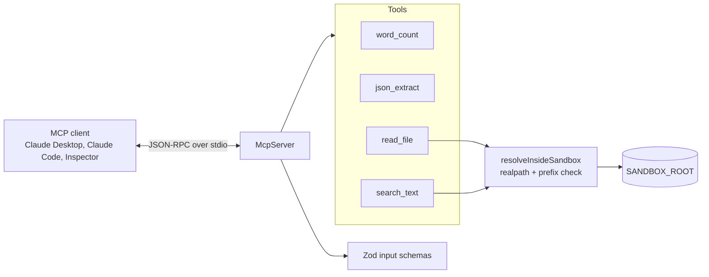

# mcp-tool-server

[](https://github.com/Ramvilla1997/mcp-tool-server/actions/workflows/ci.yml)

A [Model Context Protocol](https://modelcontextprotocol.io) server that gives an AI client four small, read-only tools. Any MCP-compatible client can use them, such as Claude Desktop or Claude Code.

The interesting part is not the tools. It's the boundary around them: every input is schema-validated, the file tools cannot leave a sandbox directory (symlinks included), and a tool failure is returned to the model as a readable error instead of crashing the server.

## Architecture



| Tool | What it does | Guardrails |
|------|--------------|------------|
| `word_count` | Words, sentences, characters, reading time | Text capped at 100 KB |
| `json_extract` | One value from a JSON document, for example `orders[0].total` | Path grammar checked first; never evaluated; own-property lookup only |
| `read_file` | UTF-8 text file from the sandbox | Path resolved with `realpath`; must stay inside the sandbox; size limit |
| `search_text` | Literal substring search across sandbox files | No regular expressions (no ReDoS); depth, file-count, and result caps; symlinks skipped |

## Quick start

Requires Node.js 20 or later.

```bash
npm install
npm run build
npm test      # 20 tests, including a full client-server round trip
npm run demo  # calls the built server through the MCP Inspector CLI
```

Run the server on its own with `npm start`. It speaks MCP over stdio, so it waits for a client. Set `SANDBOX_ROOT` and `MAX_FILE_BYTES` in the environment to change the sandbox directory or the file size limit. The values in `.env.example` are a reference; load them with `node --env-file=.env dist/index.js`.

## Connect a client

Add the server to any MCP client that reads a JSON config. Use an absolute path to the built file:

```json
{
  "mcpServers": {
    "sandbox-tools": {
      "command": "node",
      "args": ["/absolute/path/to/mcp-tool-server/dist/index.js"],
      "env": { "SANDBOX_ROOT": "/absolute/path/to/a/folder/you/want/to/share" }
    }
  }
}
```

Point `SANDBOX_ROOT` at a folder you're comfortable exposing. Every file tool is limited to it.

## Demo output

`npm run demo` launches the server with the MCP Inspector CLI and checks each result. This is the real output, condensed:

```
== tools/list
"json_extract"  "read_file"  "search_text"  "word_count"

== search_text: webhook
"file": "notes/meeting-2026-03-30.md",
"line": 7,
"text": "- Rotate the webhook signing secret before the partner migration."

== json_extract: orders[0].total
{ "value": 398 }

== read_file: sandbox escape must be refused
"text": "No file or directory at \"../../etc/passwd\"",
"isError": true

Demo passed: 4 checks, all as expected.
```

## Security notes

- **Path traversal:** `resolveInsideSandbox` resolves the requested path against the sandbox root, then calls `realpath` so symlinks are followed before the check. Tests cover `../` traversal, absolute paths outside the root, and a symlink inside the sandbox that points outside it.
- **No code execution:** `json_extract` walks the parsed JSON with a restricted path grammar. Nothing from the input is evaluated, and `__proto__` and other prototype keys are treated as missing properties.
- **Bounded work:** every input has a length limit, and the search is capped by depth, file count, and result count.
- **Read-only annotations:** each tool declares `readOnlyHint: true`, so well-behaved clients can skip confirmation prompts.
- **Errors:** tool failures return `isError: true` with a message that is safe to show. Unexpected exceptions are logged to stderr, and stdout is reserved for the protocol.
- **Dependencies:** zero known vulnerabilities in production dependencies (`npm audit --omit=dev`). CodeQL and Dependabot run in CI.

## Limitations

- The tools are read-only by design. Write tools need a confirmation design before they should exist.
- `search_text` is a literal scan, not an index. It's fine for a sandbox of notes and small data files, not for large trees.
- The Inspector demo pins `@modelcontextprotocol/inspector@2.12.0`. Update the pin deliberately, not automatically.

## Project layout

```
src/
  index.ts          stdio entry point
  server.ts         McpServer, tool registration, error mapping
  sandbox.ts        path confinement and bounded search
  tools/            word_count and json_extract logic
  config/env.ts     Zod-validated configuration
sandbox/            sample notes and data for the demo
tests/              sandbox guard, tool logic, and protocol-level tests
scripts/demo.sh     Inspector-driven verification
```

## License

MIT

---

More projects by Ram Villa: [github.com/Ramvilla1997](https://github.com/Ramvilla1997)
